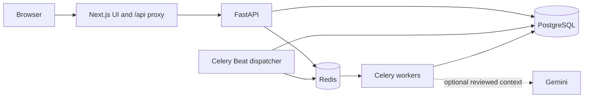

# Architecture

## Components

| Component | Responsibility |
| --- | --- |
| Next.js | Pages, client state, and server-side forwarding to FastAPI |
| FastAPI | Authentication, authorization, sessions, scoring, and admin APIs |
| PostgreSQL | Users, approved questions, drafts, attempts, assessments, batches, jobs |
| Redis | Celery transport, distributed limits, AI quota/cache coordination |
| Celery worker | Background question generation and validated publication |
| Celery Beat | Periodic dispatch and expired-lease recovery; run one instance |
| Gemini | Optional selection among four reviewed neutral context phrases |

The browser uses `/api`. The Next.js proxy reads `API_INTERNAL_URL` at runtime; database and AI credentials stay server-side. Compose publishes only the web port on loopback.

## Question generation

1. An administrator requests a topic/difficulty batch; PostgreSQL records every job.
2. A dispatcher reserves jobs under a per-bucket database lock; remaining jobs stay pending.
3. Redis delivers messages to Celery workers.
4. A worker samples valid parameters from a registered mathematical model, or selects a curated CS fact.
5. The canonical solver calculates the answer and solution; distractors use known mistakes where available, otherwise numeric fallbacks.
6. Independent verification and publication checks reject invalid parameters, answers, units, wording, solutions, or repeated options.
7. A logical fingerprint rejects duplicate items. Cosmetic names/context do not create new identities.
8. The approved question and successful job state commit in the same transaction.

There are 21 quantitative models: 18 original structures plus three multi-stage motion/work/tank models. Gemini cannot change formulas, facts, answers, options, or solutions. Missing credentials, invalid AI output, and timeouts fall back to canonical wording. Experimental unrestricted AI modules remain outside the production publication path.

## Job recovery

Statuses: `pending → queued → running → succeeded/rejected/failed`.

Leases recover interrupted jobs. Dispatch tokens prevent stale or redelivered tasks from publishing under a newer reservation. Unexpected failures retry with backoff; exhausted quality/duplicate attempts are rejected. Database records track work durably; Redis alone is not the work ledger. A requested count is not a guarantee that every item will pass publication.

## Practice

Starting a set selects approved questions and persists a session. A user-row lock and partial unique index enforce one active set per account. Answers and question position autosave with optimistic revision numbers; stale tabs must reload. Submission locks the session, scores server-side, and stores the result. Repeated submissions return that result without creating another attempt.

Completed questions leave normal unseen inventory; explicit revision mode allows reuse. Saved solutions remain hidden until completion. Server timestamps determine elapsed time.

## Assessments

An administrator defines topic/difficulty slots. Reusable variants are prepared before activation. HMAC-based assignment selects a candidate's variant; the persisted presentation seed reproduces question/option order after refresh. Candidate start reads prepared inventory and does not call Gemini.

Deadlines are server-controlled. Late submission scores only previously saved answers. Review follows release policy. Shared blueprints enforce structural distribution, not statistically proven item equivalence.

## Security and tradeoffs

- Argon2id password hashing; supported legacy hashes upgrade after login.
- JWTs in HttpOnly cookies; database roles enforce administrator access.
- Token versions revoke existing account tokens on logout.
- Cookie-authenticated writes require an allowed Origin; scoring and ownership checks run on the server.
- PostgreSQL transactions protect session submission and question publication.
- Redis failure can block rate-limited operations under the default fail-closed setting.
- Model coverage and CS facts are finite. Difficulty is curated; first-exposure statistics are provisional, not psychometric calibration.
- More workers/API replicas are possible, but database pools and dispatch caps must be sized together. Large-event capacity has not been established by load testing.
